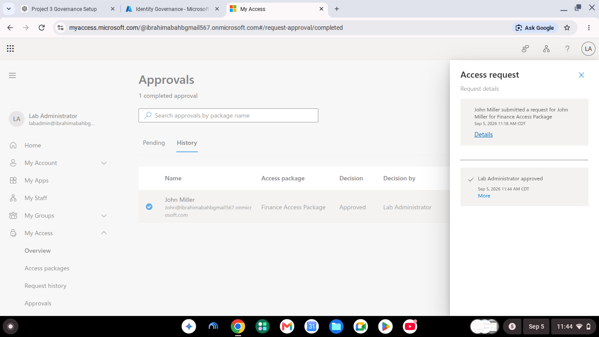
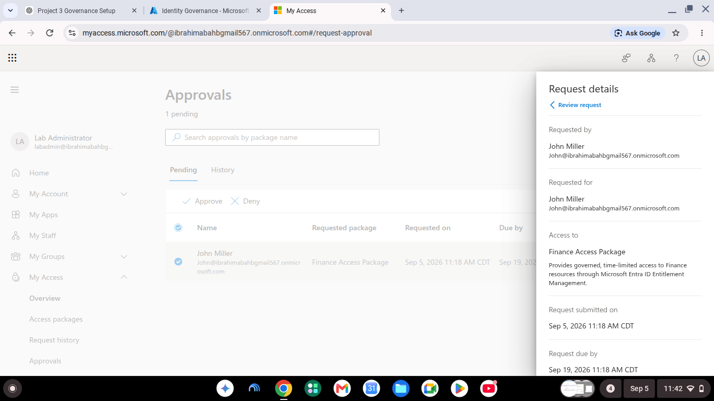

# Microsoft Entra Identity Governance & PIM Lab

## Project Overview

This hands-on IAM project demonstrates how Microsoft Entra ID can be used to govern both standard and privileged access.

The lab implements **Entitlement Management, Access Packages, approval workflows, Access Reviews, and Privileged Identity Management (PIM)** to demonstrate controlled access provisioning, periodic governance, Just-in-Time privileged access, approval, and deactivation.

---

## Technologies & Concepts

- Microsoft Entra ID
- Microsoft Entra Identity Governance
- Entitlement Management
- Access Packages
- Access Reviews
- Privileged Identity Management (PIM)
- Role-Based Access Control (RBAC)
- Just-in-Time (JIT) privileged access
- Approval workflows
- Least Privilege
- Identity lifecycle management

---

# Part 1 — Finance Access Package

A **Finance Access Package** was configured to provide governed access to Finance resources.

The package was configured with:

- User request workflow
- Business justification
- Administrator approval
- 30-day assignment lifecycle
- Extension approval
- Finance security group membership

## Access Package Request

John Miller requested access to the Finance Access Package through Microsoft My Access.



## Access Package Approval

The request was reviewed and approved by the designated administrator.



## Access Provisioning

After approval, John Miller was automatically added to the Finance access group.


This demonstrates automated entitlement provisioning rather than manually granting access directly to the user.

---

# Part 2 — Access Lifecycle & Deprovisioning

The access package was configured with a limited assignment lifecycle.

When the assignment was removed, access was automatically removed from the associated Finance resource.


This demonstrates the **Joiner-Mover-Leaver and least-privilege principle** by ensuring access does not remain indefinitely.

---

# Part 3 — Access Reviews

Recurring Access Reviews were configured for the Finance Access Package.

The review was configured to periodically verify whether users should continue to retain access.


A scheduled review was successfully generated.


This provides an auditable process for periodically validating access instead of allowing permissions to remain permanently assigned.

---

# Part 4 — Privileged Identity Management (PIM)

Microsoft Entra Privileged Identity Management was used to implement **Just-in-Time privileged access**.

John Miller was configured as an **eligible User Administrator** rather than maintaining permanent administrative privileges.

## Eligible Role Assignment

The User Administrator role was assigned as an eligible privileged role.


## PIM Activation Request

John requested temporary activation of the User Administrator role.


The activation included a business justification and limited activation period.

## Administrator Approval

The privileged-role activation request was reviewed and approved by the administrator.


## Temporary Privileged Access

After approval, the User Administrator role became temporarily active.


This demonstrates **Just-in-Time administration**, reducing the risks associated with standing administrative privileges.

## Privileged Role Deactivation

The privileged role was manually deactivated when administrative work was complete.


This validates the complete privileged-access lifecycle:

**Eligible → Request → Approval → Activation → Administrative Access → Deactivation**

---

# Security Outcomes

This project demonstrates several enterprise IAM security principles:

| Security Principle | Implementation |
|---|---|
| Least Privilege | Access granted only when required |
| Just-in-Time Access | PIM provides temporary privileged roles |
| Approval Governance | Access and privileged-role requests require approval |
| Access Certification | Access Reviews periodically validate permissions |
| Automated Provisioning | Access Packages provision group membership |
| Automated Deprovisioning | Access is removed when assignments end |
| Separation of Duties | User requests and administrator approvals are separated |
| Auditing | Entra records requests, approvals, assignments, and PIM activity |

---

# Project Workflow

```text
Standard Access

User Request
     ↓
Access Package
     ↓
Administrator Approval
     ↓
Finance Group Membership
     ↓
Access Review
     ↓
Access Retained or Removed


Privileged Access

Eligible User Administrator
     ↓
PIM Activation Request
     ↓
Business Justification
     ↓
Administrator Approval
     ↓
Temporary User Administrator
     ↓
Role Deactivation
```

---

# Key Takeaways

Through this lab I gained hands-on experience configuring and validating:

- Microsoft Entra Entitlement Management
- Access Packages
- Approval workflows
- Access lifecycle controls
- Access Reviews
- Privileged Identity Management
- Eligible privileged roles
- Just-in-Time administrative access
- Privileged-role approval and deactivation

The project demonstrates how Microsoft Entra ID can combine **identity lifecycle management, access governance, and privileged access management** to reduce excessive permissions and enforce Zero Trust principles.

---

## Screenshots

Additional project evidence is available in the [`Screenshots`](./Screenshots) directory.
